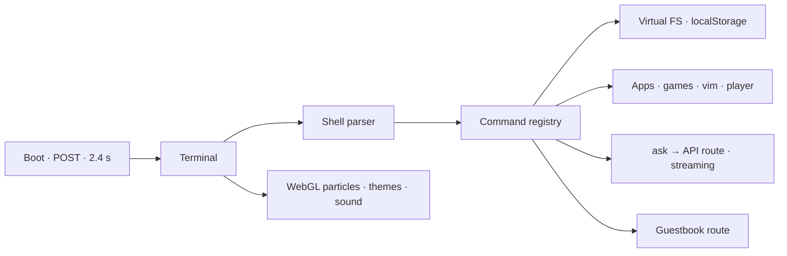

<div align="center">



<p>
  <a href="https://kut-os.vercel.app"></a>
  
  
  
</p>

<p><em>Not a portfolio site but a tiny operating system that lives in your browser.<br>
It boots, it has a file system, games, a music player, an assistant and more easter eggs than it admits.</em></p>

</div>


## What it is

KUT/OS starts with a CRT-style POST sequence and drops you into a real shell: a custom parser, a command registry, fuzzy autocomplete and <kbd>Ctrl</kbd> <kbd>R</kbd> history search. The portfolio is something you explore with `ls`, `cat` and `open`, not something you scroll.

```
~/kut.os ➜ help
~/kut.os ➜ ls projects
~/kut.os ➜ cat about.md
~/kut.os ➜ ask what do you build?
~/kut.os ➜ play
```


## Features

| | |
|---|---|
| **Real shell** | Custom parser, command registry, fuzzy autocomplete and reverse history search. |
| **Virtual file system** | `ls`, `cd`, `cat`, `mkdir`, `touch`, `rm`, `mv`, `tree`, persisted to `localStorage`. |
| **Three themes** | Minimal (green), Cyberpunk (magenta) and Mainframe (IBM green). |
| **Mini games** | Snake, Tetris and Matrix rain, fullscreen and keyboard driven. |
| **Assistant** | `ask <question>` streams an answer grounded in the portfolio. |
| **Music player** | `play` starts lo-fi tracks with keyboard controls and a status-bar readout. |
| **Vim editor** | Normal, insert and command modes, `:wq` and `:q!`, saving to the virtual FS. |
| **Guestbook** | Visitors can leave a message through an API route. |
| **WebGL backdrop** | A Three.js particle field that reacts to your typing. |
| **Sound** | UI sounds synthesised in Web Audio, with no audio file dependencies. |
| **15+ easter eggs** | The Konami code, a night mode, hidden commands. Good luck. |


## How it fits together




## Thirty-eight commands

Every command is a small module registered with the shell, grouped by what it touches:

| Group | Commands |
|---|---|
| **core** | `help` · `clear` · `echo` · `whoami` |
| **fs** | `ls` · `cd` · `pwd` · `cat` · `mkdir` · `touch` · `rm` · `mv` · `tree` |
| **portfolio** | `about` · `projects` · `experience` · `skills` · `resume` · `now` · `contact` · `social` |
| **apps** | `snake` · `tetris` · `matrix` · `vim` · `play` · `guestbook` |
| **meta** | `ask` · `history` · `theme` · `sound` · `share` |
| **easter** | `sudo` · `rm -rf` · `coffee` · `hire-me` · and a command that lists the eggs you have found |

The parser and the registry have their own Vitest suites, so a new command cannot quietly break the shell.


## Behind the shell

| Piece | Detail |
|---|---|
| **`ask`** | A server route streams an answer from Claude (Haiku), grounded in a system prompt written from the portfolio. A per-IP rate limit (20 an hour) keeps a single visitor from looping it. |
| **Guestbook and visitors** | Two small API routes keep guestbook messages and a visitor count in memory per deployment instance, with a clear seam to swap in a KV store. |
| **Music** | A built-in track list plays through Howler; a now-playing route is ready for a Spotify hook. |
| **File system** | A seeded tree of portfolio files; anything you create or delete persists in `localStorage`. |
| **Share** | Open-graph images are rendered on the edge for shared links. |


## Türkçe özet

**KUT/OS**, klasik bir portfolyo sitesi değil; tarayıcıda açılan küçük bir terminal işletim sistemi. CRT tarzı bir açılışla başlıyor, gerçek bir kabuk (komut ayrıştırıcı, otomatik tamamlama, geçmiş arama) ve sanal bir dosya sistemi sunuyor. Portfolyo `ls`, `cat` ve `open` komutlarıyla geziliyor. İçinde Snake, Tetris, Vim editörü, müzik çalar, ziyaretçi defteri, portfolyo hakkında soru cevaplayan bir asistan ve 15'ten fazla gizli sürpriz var.


## Development

```sh
pnpm install
cp .env.local.example .env.local   # ANTHROPIC_API_KEY for `ask`
pnpm dev                           # http://localhost:3000
pnpm test                          # vitest
pnpm type-check
pnpm build
```

```
commands/     core, fs, portfolio, apps, meta and easter-egg commands
lib/shell/    parser, registry, autocomplete, history
lib/fs/       virtual file system
components/   terminal, boot sequence, apps, effects
content/      the portfolio as files
app/api/      assistant, guestbook and music routes
```

<div align="center">
<br>
<a href="https://github.com/kutluhangil"></a>
<sub>~/kut.os ➜ type <code>help</code> to begin · the session in the banner is illustrative</sub>
</div>
